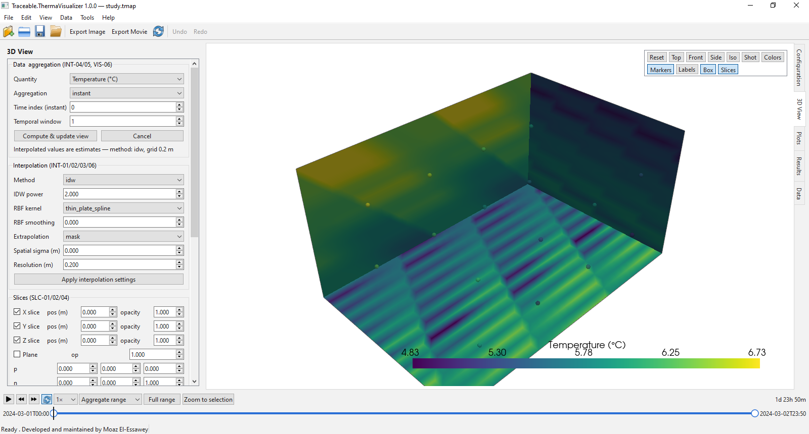
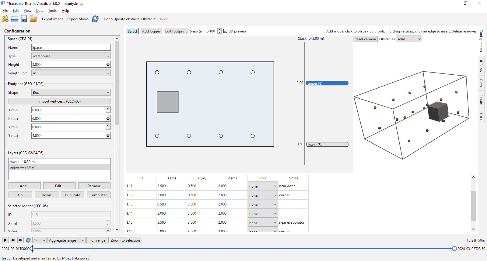
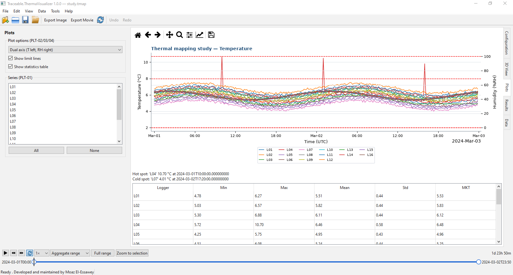
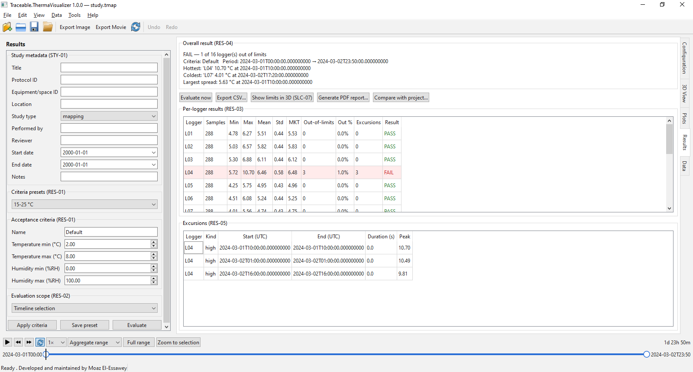

# Traceable.ThermaVisualizer


Desktop application (Python 3.11+ / PySide6 / PyVista–OpenGL) for designing,
loading, visualizing, and exporting thermal mapping (temperature / relative
humidity) studies in pharmaceutical facilities: warehouses, cold rooms,
cabinets, and chambers.

Developed and maintained by **Moaz El-Essawey** — an open-source tool shared with
the community.

> **Scope note:** the built-in audit trail is a lightweight record of user
> actions (who, what, when). It is **not** a 21 CFR Part 11 compliance claim
> and there are no electronic signatures.

**Status: v1.0.0-rc1** — milestones M0–M7 complete. M8 (PDF report, study
comparison) is next.

## Features
- 3D logger layout: layers, polygon (non-box) footprints, obstacles, bulk
  CSV/XLSX import, lattice generator, full undo/redo, live 3D preview
- Data loading: CSV/TXT/XLSX with reusable parsing profiles, preview, thorough
  validation (VAL-01..11) with exportable report
- Logger→column mapping with auto-suggest and a completeness gate; multi-file
  merge on a common time base (nearest/linear, max-gap masking)
- 3D heat map: IDW/RBF/linear/trilinear interpolation on a geometry-masked
  voxel grid, slices (X/Y/Z/arbitrary), color maps with fixed/auto range,
  limit-exceedance highlight, probe
- Timeline: range selection + playback driving the 3D view, plots, statistics
- Plots (matplotlib): multi-series, dual-axis, statistics incl. MKT, limit
  lines, hot/cold spot summary with door/vent/evaporator context
- Results: acceptance-criteria presets, per-logger & overall pass/fail,
  excursion tables, CSV export
- Exports: PNG screenshots, MP4/GIF movies (offscreen rendering), aligned data
  CSV/XLSX, volumes NPZ, slices CSV/PNG, validation & results CSV — all
  audit-logged with file hashes
- Project files: single `.tmap` (zip) with SHA-256 integrity, schema
  migrations, embedded raw data and audit trail; autosave/recovery
- Light / dark / system themes
- Startup splash screen with the thermal-ramp brand motif

## Requirements
- Python 3.11+; Windows 10/11 (primary), Ubuntu LTS (secondary), macOS best effort
- OpenGL 3.3 capable GPU/driver (a labeled fallback appears if unavailable)

## Install & run
```bash
python -m venv .venv
source .venv/bin/activate        # Windows: .venv\Scripts\activate
pip install -e ".[dev]"
python -m thermavisualizer
```

## Quick tour (16-logger demo)
1. `python tests/data/generate_demo_files.py`
2. Configuration tab: set the space to 6 × 4 × 3 m → Bulk layout ▸ Import
   layout… → `tests/data/demo_layout_16.csv`
3. File ▸ Import Data… → `tests/data/demo/demo_data_16.csv`, auto-suggest the
   mapping, confirm
4. 3D View tab: Compute & update view; enable a Z slice; set limits 2–8 °C
5. Timeline: select a range or press play; Plots and Results follow
6. File ▸ Save Project (`.tmap`); File ▸ Export for movie/image/data

## Screenshots





Regenerate with `QT_QPA_PLATFORM=offscreen python docs/make_screenshots.py`.
Capture the `3d_view.png` on a GPU machine for a populated canvas.

## Binary build (Windows/Linux)
```bash
pip install -e ".[dev]"                     # includes pyinstaller
python -m PyInstaller packaging/thermavisualizer.spec --noconfirm --clean
# result: dist/ThermaVisualizer/ThermaVisualizer.exe
```

## Development
```bash
ruff format --check .
ruff check .
mypy src/thermavisualizer/core src/thermavisualizer/io
QT_QPA_PLATFORM=offscreen pytest -q
```
See `CONTRIBUTING.md`, `docs/user_manual.md`, `AGENTS.md`, and
`PRD_Traceable_ThermaVisualizer.md` (requirements source of truth).

## License
Apache License 2.0 — see [LICENSE](LICENSE) and [NOTICE](NOTICE). PySide6/Qt is
LGPL; distributed builds dynamically link Qt and respect LGPL obligations.